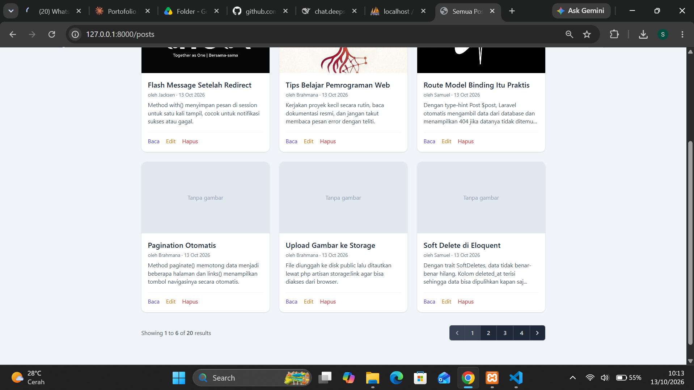
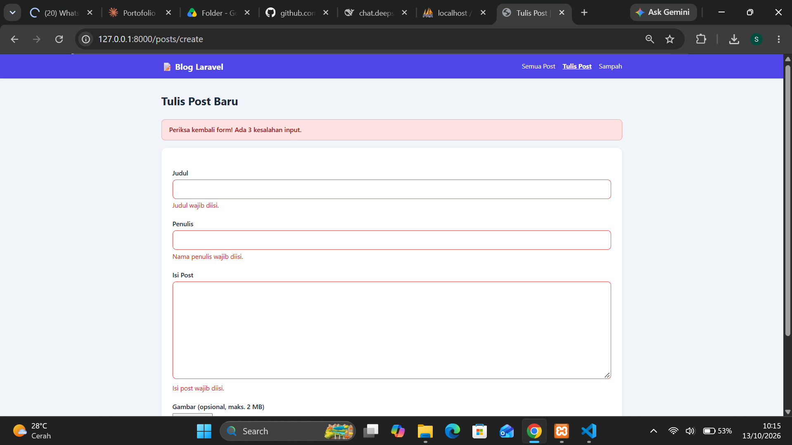
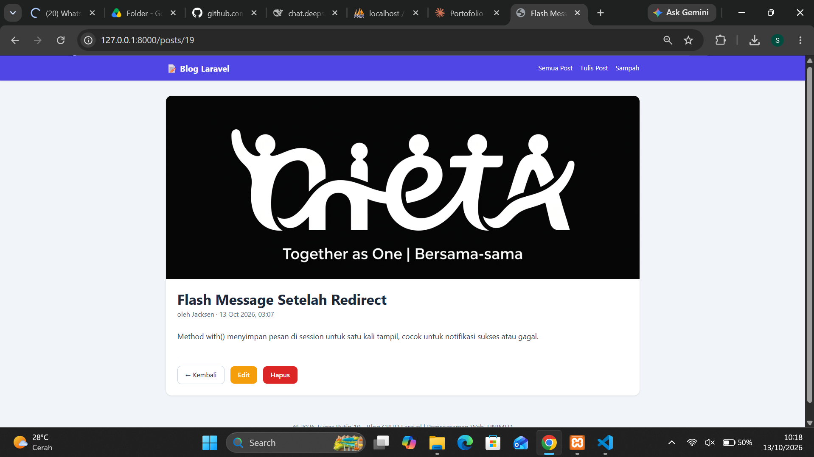
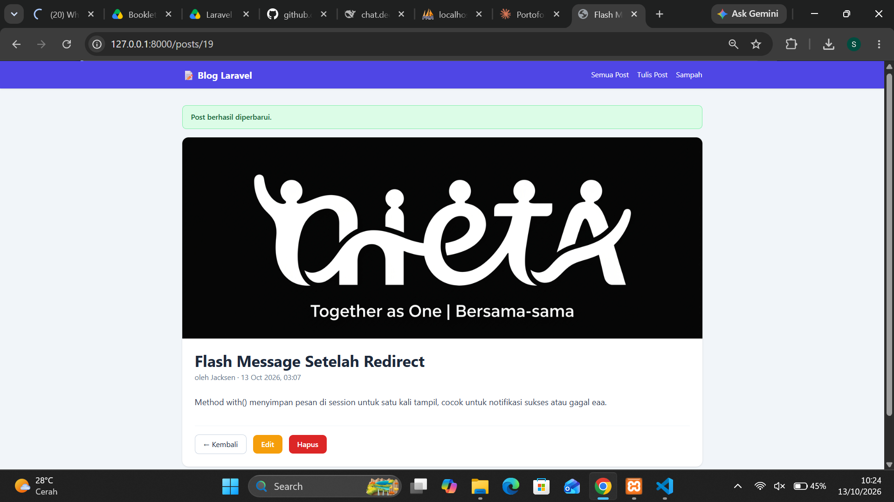
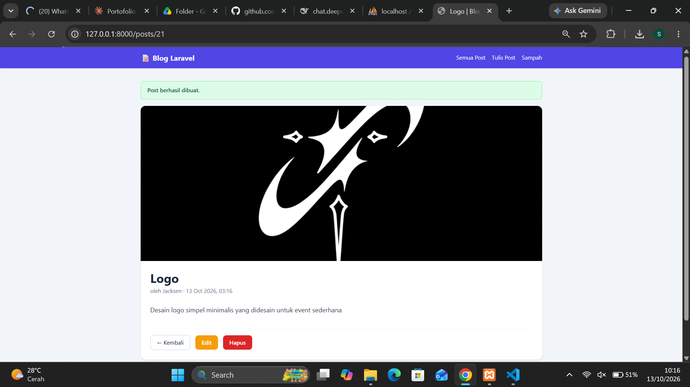

# TugasWeb-P10-BlogCRUD

**Tugas Rutin 10: Blog CRUD Laravel**
Nama: Samuel Jacksen Brahmana | Pemrograman Web, UNIMED

Aplikasi blog sederhana dengan CRUD lengkap, dibangun dengan Laravel 12 (pola MVC).

## Screenshot

| Halaman | Screenshot |
|---|---|
| Daftar post (pagination) |  |
| Form tambah dengan error per field |  |
| Detail post (Route Model Binding) |  |
| Form edit (pre-filled) |  |
| Flash message sukses |  |
| Daftar route (`route:list`) |  |

## Cara Menjalankan

Prasyarat: PHP 8.2, Composer, dan MySQL aktif (XAMPP).

```bash
git clone https://github.com/jacksenbrhm/TugasWeb-P10-BlogCRUD.git
cd TugasWeb-P10-BlogCRUD
composer install
cp .env.example .env          # Windows CMD: copy .env.example .env
php artisan key:generate
```

Buat database `blog_db` di phpMyAdmin, lalu atur `.env`:

```env
DB_CONNECTION=mysql
DB_HOST=127.0.0.1
DB_PORT=3306
DB_DATABASE=blog_db
DB_USERNAME=root
DB_PASSWORD=
```

```bash
php artisan migrate
php artisan db:seed --class=PostSeeder   # 10 data contoh
php artisan storage:link                 # agar gambar upload tampil
php artisan serve
```

Buka `http://127.0.0.1:8000`.

## Route (Route::resource)

| Method | URL | Action | Nama Route |
|---|---|---|---|
| GET | `/posts` | index | `posts.index` |
| GET | `/posts/create` | create | `posts.create` |
| POST | `/posts` | store | `posts.store` |
| GET | `/posts/{post}` | show | `posts.show` |
| GET | `/posts/{post}/edit` | edit | `posts.edit` |
| PUT/PATCH | `/posts/{post}` | update | `posts.update` |
| DELETE | `/posts/{post}` | destroy | `posts.destroy` |

Route bonus (soft delete): `posts.trash`, `posts.restore`, `posts.force-delete`.

## Struktur MVC

| Bagian | File |
|---|---|
| Route | `routes/web.php` |
| Controller (7 method + trash) | `app/Http/Controllers/PostController.php` |
| Validasi | `app/Http/Requests/PostRequest.php` |
| Model | `app/Models/Post.php` |
| Layout master | `resources/views/layouts/app.blade.php` |
| Komponen | `resources/views/components/alert.blade.php`, `card.blade.php` |
| View | `resources/views/posts/` (index, create, edit, show, trash, `_form`) |
| Migration dan seeder | `database/migrations/*_create_posts_table.php`, `database/seeders/PostSeeder.php` |

## Requirements

- [x] `Route::resource('posts')` dan named routes
- [x] `PostController` resource (7 method)
- [x] Blade layout master (`@extends` / `@yield`)
- [x] Minimal 2 komponen: `<x-alert>` dan `<x-card>`
- [x] Validasi, pesan error per field, dan `old()` input
- [x] Flash message sukses dan gagal
- [x] `@csrf` di semua form POST, `@method('PUT')` / `@method('DELETE')` untuk spoofing
- [x] Route Model Binding dan pagination (`paginate(6)`)
- [x] **Bonus:** pencarian, soft delete (sampah, pulihkan, hapus permanen), dan upload gambar
